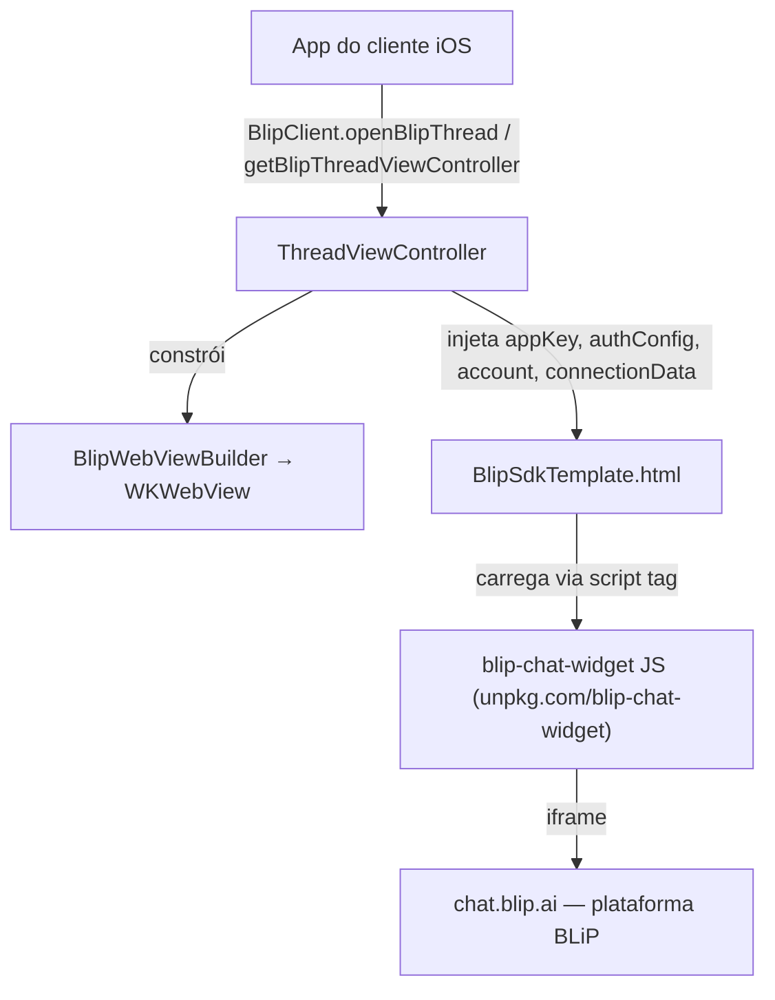

# Arquitetura

## Visão geral

## Componentes principais (`src/BlipChat/`)

| Arquivo                               | Responsabilidade                                                                                                                                                                                                                                                                                                                                |
| ------------------------------------- | ----------------------------------------------------------------------------------------------------------------------------------------------------------------------------------------------------------------------------------------------------------------------------------------------------------------------------------------------- |
| `BlipClient.swift`                    | Fachada pública (`@objc`). Valida config (`validateSdkConfiguration`), monta o `ThreadViewController` via Storyboard e decide apresentação (push vs. child VC).                                                                                                                                                                                 |
| `ThreadViewController.swift`          | Controller que hospeda a `WKWebView`. Carrega `BlipSdkTemplate.html`, substitui placeholders (`%appKey%`, `%authConfig%`, `%account%`, `%connectionData%`, `%scriptSdkUrl%`, `%iframeUrl%`, `%customCommonUrl%`) e trata teclado (ajusta constraint inferior e envia `setKeyboardOpen` via `evaluateJavaScript`), orientação e botão de voltar. |
| `BlipWebViewBuilder.swift`            | Builder que configura a `WKWebView` (delegates de navegação, UI, scroll/zoom e observer de `estimatedProgress`).                                                                                                                                                                                                                                |
| `BlipSdkTemplate.html`                | Template HTML/JS carregado na WebView. Instancia `new BlipChat()` (API do `blip-chat-widget`) com `withAppKey`, `withTarget`, `withAuth`, `withAccount`, `withConnectionData`, `withCustomCommonUrl`.                                                                                                                                           |
| `BlipOptions.swift`                   | Objeto de configuração público. Serializa `authConfig`/`account`/`connectionDataConfig` para JSON (usado para preencher o template HTML).                                                                                                                                                                                                       |
| `AuthType.swift`                      | `AuthConfig` + enum `AuthType` (`.Guest` / `.Dev`). Guest não usa credenciais; Dev requer `userIdentity` + `userPassword` (validado em `BlipClient.validateSdkConfiguration`).                                                                                                                                                                  |
| `Account.swift`                       | Dados de perfil do usuário final (nome, email, telefone, extras, etc.), `Encodable`, viram JSON injetado no template.                                                                                                                                                                                                                           |
| `ConnectionDataConfig.swift`          | Customização de domínio/host/porta da conexão (multi-tenant/organização própria).                                                                                                                                                                                                                                                               |
| `Constants.swift`                     | URLs padrão (`BLIP_SDK_URL = unpkg.com/blip-chat-widget`, `IFRAME_URL = chat.blip.ai`) e chaves de placeholder do template.                                                                                                                                                                                                                     |
| `BlipErrors.swift`                    | Enum de erros lançados (`emptyApiKey`, `emptyCredentials`, `emptyNoNavController`).                                                                                                                                                                                                                                                             |
| `NavigationControllerExtension.swift` | Extensão de `UINavigationController` para repassar rotação/orientação preferida do view controller visível (necessário pois o chat costuma ser empurrado sobre outra navigation stack).                                                                                                                                                         |
| `StringExtension.swift`               | Helpers de base64 (`toBase64`/`fromBase64`/`obfuscate`) — usados para não deixar credenciais em texto plano nos parâmetros injetados no HTML.                                                                                                                                                                                                   |
| `Storyboard.storyboard`               | Define o layout do `ThreadViewController` (identifier `ThreadViewController`), carregado via `Bundle.module` (SPM) ou `Bundle(for:)` (CocoaPods).                                                                                                                                                                                               |

## Empacotamento de recursos (dual SPM/CocoaPods)

O código detecta o mecanismo de distribuição em tempo de build com `#if SWIFT_PACKAGE`:

- **SPM**: usa `Bundle.module` (recursos processados declarados em `Package.swift`: storyboard, assets, HTML).
- **CocoaPods**: usa `Bundle(for: Self)` e tenta localizar um bundle de recursos separado (`BlipChat.bundle`), com fallback para o bundle principal.

Isso é um ponto sensível: qualquer novo recurso adicionado ao SDK precisa ser declarado tanto em `Package.swift` (`resources:`) quanto considerado no fluxo de fallback do CocoaPods.

## Nenhum estado de rede/protocolo é implementado em Swift

Toda a lógica de conexão com a plataforma BLiP (LIME protocol, autenticação, envio/recebimento de mensagens) vive no `blip-chat-widget` (JavaScript, carregado dinamicamente da web) e não neste repositório. O código Swift é essencialmente um **shell nativo + bridge de configuração** para essa WebView.
